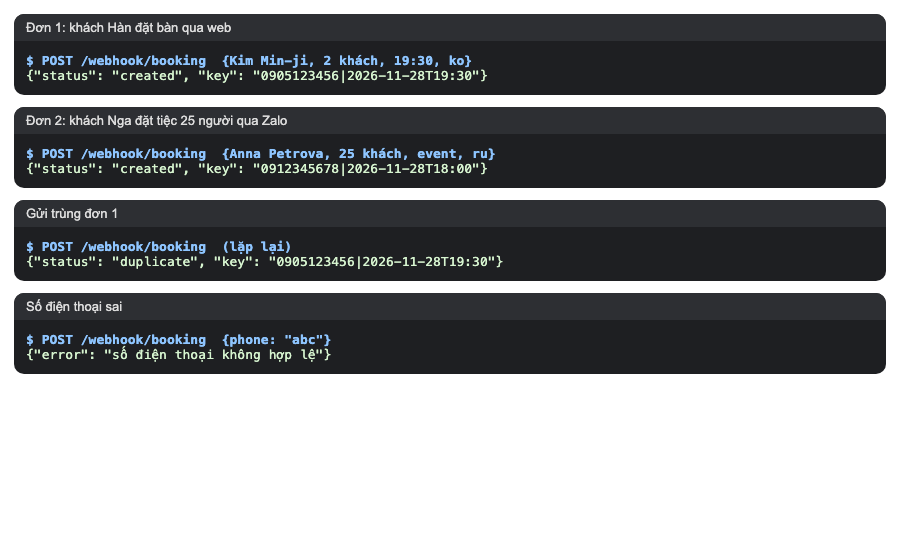
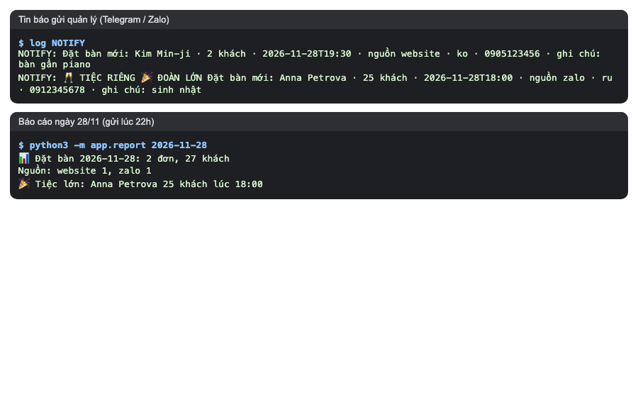
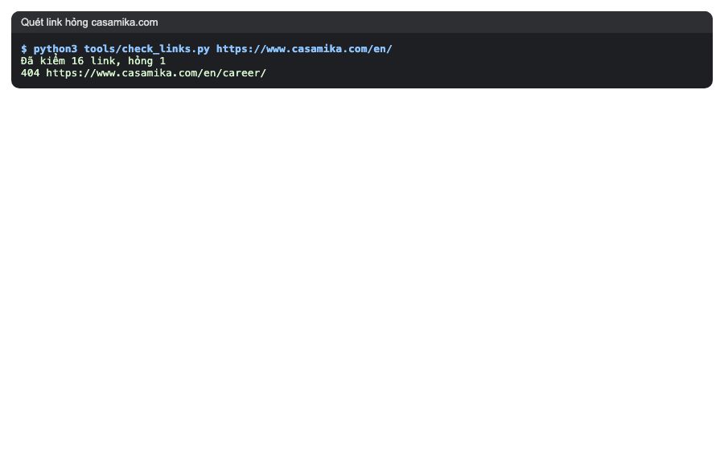
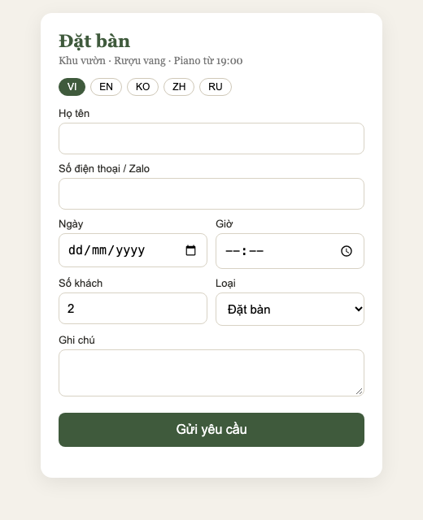

# Hướng dẫn casa-ops-automation cho Casa Mika

Tài liệu giải thích hệ thống làm gì, đã kiểm thử ra sao, khớp với cách Casa Mika vận hành tới đâu, và cách chạy từng bước.

## 1. Hệ thống giải quyết việc gì của Casa Mika

Casa Mika nhận khách qua nhiều đường: nút Reserve dẫn sang Google Maps, điện thoại, Zalo, Facebook, khách đặt tiệc riêng và tiệc cưới. Quán mở từ sáng tới khuya, nhiều ca, khách nói nhiều thứ tiếng (website có 7 ngôn ngữ). Khi đơn nằm rải rác ở nhiều nơi, dễ sót đơn, quản lý không biết tối nay có bao nhiêu khách, tiệc lớn không được chuẩn bị trước.

Hệ thống gom mọi đơn về một Google Sheet, báo ngay cho quản lý qua Telegram hoặc Zalo, đánh dấu tiệc riêng và đoàn lớn, gửi báo cáo lúc 22h, và tự báo khi có lỗi.


## 2. Đã kiểm thử những gì

### 2.1 Kiểm thử tự động: 7/7 đạt
Kiểm: chuẩn hóa số điện thoại +84, thiếu trường, giờ sai định dạng, giờ đã qua, gửi thông báo thử lại 3 lần khi mạng lỗi, luồng webhook đầy đủ, báo cáo ngày.


### 2.2 Chạy thử với tình huống của Casa Mika
- Khách Hàn đặt bàn 2 người lúc 19:30, ghi chú "bàn gần piano" → nhận đơn.
- Khách Nga đặt tiệc sinh nhật 25 người qua Zalo → nhận đơn, gắn nhãn tiệc riêng và đoàn lớn.
- Gửi lại đơn của khách Hàn → hệ thống nhận ra trùng, không ghi hai lần.
- Số điện thoại "abc" → bị từ chối, báo rõ lý do.



### 2.3 Tin báo quản lý và báo cáo cuối ngày


### 2.4 Quét link hỏng trên casamika.com (chạy thật ngày 25/11/2026)


## 3. Form đặt bàn ngay trên website, 5 ngôn ngữ

Hiện nút Reserve đưa khách rời website sang Google Maps, quán không giữ được dữ liệu khách. Form này đặt ngay trên casamika.com, có tiếng Việt, Anh, Hàn, Trung, Nga, có lựa chọn "Tiệc riêng / sự kiện". Đơn đi thẳng vào hệ thống ở trên.

| Tiếng Việt | Tiếng Hàn |
|---|---|
|  |  |

## 4. Khớp với mô hình Casa Mika tới đâu (đánh giá thật)

| Nhu cầu của Casa Mika | Hệ thống hiện tại | Mức khớp |
|---|---|---|
| Gom đơn từ web, Zalo, Facebook về một chỗ | Có: webhook + n8n + Google Sheet | Khớp |
| Tiệc riêng, tiệc cưới, đoàn lớn | Có: trường `type`, nhãn 🥂 và 🎉, ngưỡng đoàn lớn chỉnh được | Khớp |
| Khách nhiều quốc tịch | Form 5 ngôn ngữ, lưu ngôn ngữ khách để nhân viên chuẩn bị | Khớp một phần (web có 7 ngôn ngữ, form chưa có Đức, Thái) |
| Báo quản lý qua Zalo hoặc Telegram | Có cả hai, chọn bằng một biến | Khớp |
| Đơn từ Google Maps Reserve | Chưa nối tự động. Google chỉ mở cho đối tác đặt bàn chính thức. Tạm thời lễ tân nhập vào Sheet, hoặc thay nút Reserve bằng form của quán | Chưa khớp |
| Đơn qua điện thoại | Lễ tân nhập Sheet hoặc dùng form | Khớp một phần |
| Quản lý số bàn, sức chứa từng khu (vườn, nhà kính) | Chưa có | Chưa khớp, làm ở tháng 2 |
| Nhắn xác nhận tự động cho khách | Chưa có. Zalo OA chỉ nhắn được khách đã quan tâm OA hoặc qua ZNS có mẫu được duyệt | Chưa khớp, cần OA của quán |
| Nối với POS đang dùng | Chưa biết quán dùng POS nào | Cần hỏi khi phỏng vấn |

**Kết luận:** phần lõi (nhận đơn, kiểm dữ liệu, gom về Sheet, báo quản lý, báo cáo, cảnh báo lỗi) đã chạy và khớp. Ba phần cần thông tin nội bộ mới làm tiếp được: Google Reserve, sơ đồ bàn, Zalo OA và POS.

## 5. Cách chạy từng bước

### Bước 1: Chạy thử trên máy (5 phút)
```bash
git clone https://github.com/yeuvietsub1520/casa-ops-automation
cd casa-ops-automation
python3 -m unittest discover -s tests -v     # 7 bài phải OK
NOTIFY_CHANNEL=log python3 -m app.server     # mở http://localhost:8080/booking
```
Điền form, bấm Gửi. Cửa sổ terminal hiện dòng `NOTIFY: Đặt bàn mới…`.

### Bước 2: Nối Telegram (10 phút)
1. Trong Telegram, nhắn @BotFather lệnh `/newbot`, đặt tên, nhận token.
2. Thêm bot vào nhóm quản lý, lấy chat id.
3. Tạo file `.env` từ `.env.example`, điền `NOTIFY_CHANNEL=telegram`, `TELEGRAM_BOT_TOKEN`, `TELEGRAM_CHAT_ID`.
4. Chạy lại server, gửi một đơn thử, tin nhắn hiện trong nhóm.

### Bước 3: Nối Zalo OA (cần OA của quán)
Điền `NOTIFY_CHANNEL=zalo`, `ZALO_OA_TOKEN`, `ZALO_USER_ID` (người nhận phải là người đã quan tâm OA).

### Bước 4: Google Sheet
Tạo Sheet có trang "DatBan". Trong n8n tạo kết nối Google Sheets, điền `SHEET_ID` vào `.env`.

### Bước 5: Đưa lên VPS Linux
```bash
docker compose up -d
docker compose exec n8n n8n import:workflow --separate --input=/workflows
```
Mở n8n ở cổng 5678, bật 3 workflow: đặt bàn, cảnh báo lỗi, báo cáo 22h.

### Bước 6: Đặt form lên casamika.com
Thêm trang /reserve hoặc đổi nút Reserve trỏ tới form. Bật `WEBHOOK_SECRET` khi đi thật.

## 6. Khi phỏng vấn, giải thích trong 1 phút
"Khách đặt qua web, Zalo hay Facebook đều đi vào một webhook. Hệ thống kiểm tra số điện thoại, giờ, số khách, chống trùng, rồi ghi vào Google Sheet. Quản lý nhận tin ngay trên Telegram hoặc Zalo, tiệc riêng và đoàn lớn được đánh dấu. 22h có báo cáo trong ngày. Workflow nào lỗi thì báo về ngay. Phần Google Reserve, sơ đồ bàn và POS em cần xem hệ thống nội bộ của quán để nối tiếp."
