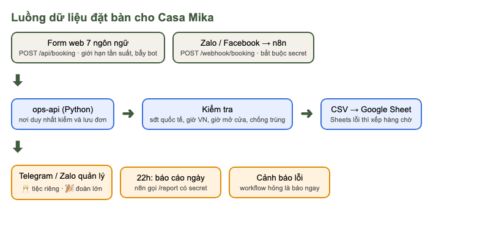
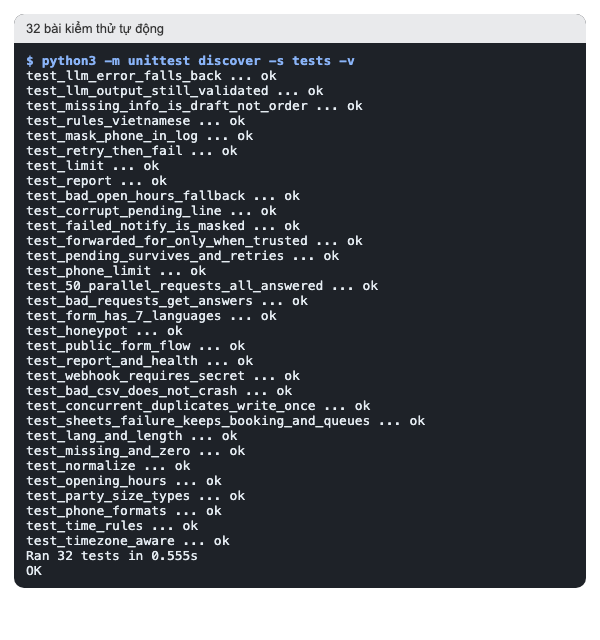
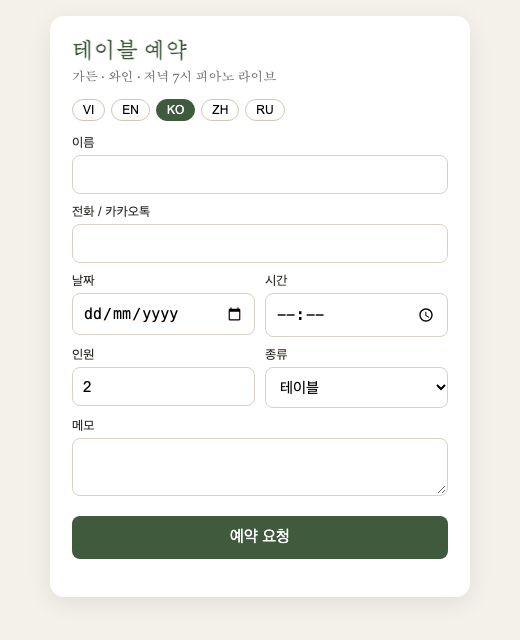
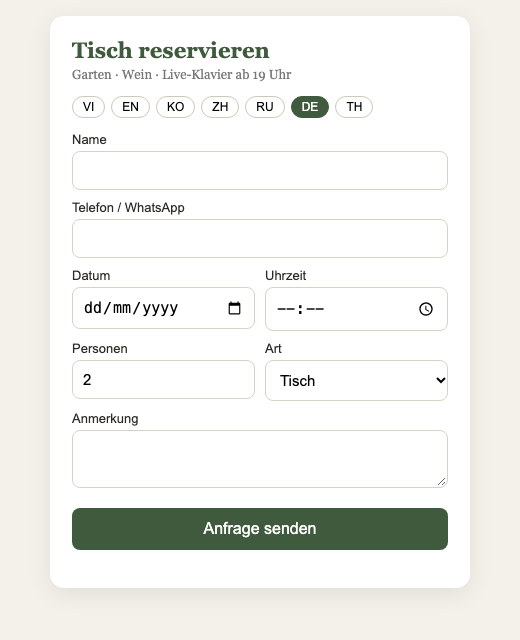

# Hướng dẫn casa-ops-automation cho Casa Mika

Tài liệu giải thích hệ thống làm gì, đã kiểm thử ra sao, khớp với cách Casa Mika vận hành tới đâu, và cách chạy từng bước. Bản cập nhật 25/11/2026, sau khi Muse kiểm thử độc lập và các lỗi tìm được đã sửa.

## 1. Hệ thống giải quyết việc gì của Casa Mika

Casa Mika nhận khách qua nhiều đường: nút Reserve dẫn sang Google Maps, điện thoại, Zalo, Facebook, khách đặt tiệc riêng và tiệc cưới. Quán mở từ 7:30 tới khuya, nhiều ca, khách nói nhiều thứ tiếng (website có 7 ngôn ngữ). Đơn nằm rải rác thì dễ sót, quản lý không biết tối nay bao nhiêu khách, tiệc lớn không được chuẩn bị trước.

Hệ thống có một nơi duy nhất kiểm và lưu đơn (ops-api). Form trên web và các kênh khác đều đổ về đây. Quản lý nhận tin ngay, tiệc riêng và đoàn lớn được đánh dấu, 22h có báo cáo, workflow lỗi thì báo về.



## 2. Đã kiểm thử những gì

### 2.1 Kiểm thử tự động: 32/32 đạt


### 2.2 Chạy thử với tình huống của Casa Mika


### 2.3 Tin báo quản lý và báo cáo ngày
Trong log, số điện thoại được che. Tin gửi Telegram hoặc Zalo cho quản lý có số đầy đủ để gọi lại khách.


### 2.4 Kiểm thử độc lập của Muse
Muse (AI agent kiểm thử) đã tải kho về máy khác, chạy 35 trường hợp khó và soát toàn bộ code. Các lỗi tìm được và đã sửa:

| Lỗi Muse tìm được | Đã sửa thế nào | Bài kiểm thử |
|---|---|---|
| 20 đơn giống nhau gửi cùng lúc ghi trùng 2 dòng | Kiểm trùng và ghi trong cùng một khóa | `test_concurrent_duplicates_write_once` |
| Gửi đồng thời bị rớt kết nối | Tăng hàng chờ kết nối lên 128 | `test_50_parallel_requests_all_answered` |
| Máy chủ ở nước ngoài thì kiểm "giờ đã qua" sai | Mọi phép tính giờ theo giờ Việt Nam +07:00 | `test_timezone_aware` |
| Giờ kèm múi giờ làm sập yêu cầu | Đổi về giờ Việt Nam trước khi kiểm | `test_timezone_aware` |
| Số Trung Quốc +86 bị từ chối | Nhận tới 15 chữ số theo chuẩn quốc tế | `test_phone_formats` |
| `84905…` và `+84905…` thành 2 đơn | Cùng quy về `0905…` | `test_phone_formats` |
| Nhận đặt bàn lúc 3h sáng, năm 2099 | Kiểm giờ nhận khách, tối đa 90 ngày | `test_opening_hours`, `test_time_rules` |
| `12.9` khách thành 12, `true` thành 1 | Chỉ nhận số nguyên | `test_party_size_types` |
| Form vỡ khi `?lang=de` | Thêm tiếng Đức, Thái; ngôn ngữ lạ quay về tiếng Việt | `test_form_has_7_languages` |
| Google Sheets lỗi thì báo khách thất bại dù đơn đã lưu | Đơn vẫn nhận, Sheets xếp hàng chờ đẩy lại, báo quản lý | `test_sheets_failure_keeps_booking_and_queues` |
| Secret mặc định tắt, so sánh không an toàn | Webhook và báo cáo bắt buộc secret, so sánh bằng `hmac.compare_digest` | `test_webhook_requires_secret` |
| Không chống spam | Form giới hạn 10 đơn/10 phút/IP, có ô ẩn bẫy bot | `test_limit`, `test_honeypot` |
| `/report` lộ tên khách | Bắt buộc secret | `test_report_and_health` |
| Số điện thoại khách nằm trong log | Che số trong log | `test_mask_phone_in_log` |
| Body lớn, sai Content-Type, Content-Length rác làm treo | Trả 413, 415, 400 rõ ràng | `test_bad_requests_get_answers` |
| File CSV hỏng làm server không chạy | Bỏ qua dữ liệu hỏng, ghi cảnh báo | `test_bad_csv_does_not_crash` |
| n8n tự kiểm riêng, khác ops-api | n8n chỉ chuyển đơn sang ops-api, ops-api là nơi duy nhất kiểm | 3 workflow đã import vào n8n 2.49.5 |
| Cổng n8n lộ ra ngoài | Chỉ mở trong máy, đi qua reverse proxy HTTPS; webhook n8n có header auth | `docker-compose.yml` |
| README nói quá 7 chỗ | Viết lại đúng với code, thêm mục "Chưa làm" | `README.md` |

### 2.5 Quét link hỏng trên casamika.com (chạy thật)


## 3. Form đặt bàn 7 ngôn ngữ

Giống 7 ngôn ngữ trên casamika.com: Việt, Anh, Hàn, Trung, Nga, Đức, Thái. Có lựa chọn "Tiệc riêng / sự kiện", chặn chọn ngày đã qua, gửi lỗi thì hiện số điện thoại quán để khách gọi.

| Tiếng Việt | Tiếng Hàn | Tiếng Đức |
|---|---|---|
|  |  |  |

## 4. Khớp với mô hình Casa Mika tới đâu

| Nhu cầu của Casa Mika | Hiện tại | Mức khớp |
|---|---|---|
| Đơn từ web về một chỗ | Form `/booking` → ops-api → CSV và Google Sheet | Khớp |
| Đơn từ Zalo, Facebook | n8n nhận rồi chuyển ops-api. Cần bot hoặc nhân viên điền theo mẫu, chưa tự đọc tin nhắn tự do | Khớp một phần |
| Tiệc riêng, tiệc cưới, đoàn lớn | Nhãn 🥂 và 🎉, ngưỡng chỉnh được | Khớp |
| Giờ mở cửa | Theo web: T2–T6 07:30–24:00, T7–CN 07:30–00:30. Thông tin khác ghi 8h–24h, cuối tuần tới 1h | Cần quán chốt giờ thật |
| Khách nhiều quốc tịch | Form 7 ngôn ngữ, nhận số quốc tế, lưu ngôn ngữ khách | Khớp |
| Báo quản lý | Telegram hoặc Zalo OA, chọn bằng `NOTIFY_CHANNEL` | Khớp |
| Đơn Google Maps Reserve | Chưa nối được: Google chỉ mở cho đối tác đặt bàn chính thức | Chưa khớp |
| Sơ đồ bàn, sức chứa vườn và nhà kính | Chưa có | Cần sơ đồ của quán |
| Nhắn xác nhận cho khách | Chưa có, cần Zalo OA hoặc ZNS có mẫu được duyệt | Cần OA của quán |
| POS, đặt cọc tiệc | Chưa có | Cần hỏi khi phỏng vấn |

## 5. Cách chạy từng bước

### Bước 1: Chạy thử trên máy (5 phút)
```bash
git clone https://github.com/yeuvietsub1520/casa-ops-automation
cd casa-ops-automation
python3 -m unittest discover -s tests -v
WEBHOOK_SECRET=thu-nghiem NOTIFY_CHANNEL=log python3 -m app.server
```
Mở `http://localhost:8080/booking`, điền form, bấm Gửi. Terminal hiện dòng `NOTIFY: Đặt bàn mới…`.

### Bước 2: Nối Telegram (10 phút)
1. Trong Telegram nhắn @BotFather lệnh `/newbot`, đặt tên, nhận token.
2. Thêm bot vào nhóm quản lý, lấy chat id.
3. `cp .env.example .env`, điền `WEBHOOK_SECRET` (tạo bằng `openssl rand -hex 24`), `NOTIFY_CHANNEL=telegram`, `TELEGRAM_BOT_TOKEN`, `TELEGRAM_CHAT_ID`.

### Bước 3: Nối Zalo OA (cần OA của quán)
`NOTIFY_CHANNEL=zalo`, `ZALO_OA_TOKEN`, `ZALO_USER_ID`. Người nhận phải đã quan tâm OA.

### Bước 4: Google Sheet qua Apps Script
Tạo Sheet có trang "DatBan", vào Tiện ích mở rộng → Apps Script, dán đoạn dưới, triển khai dạng Ứng dụng web, chép URL vào `SHEETS_WEBHOOK_URL`, đặt cùng chuỗi bí mật vào `SHEETS_SECRET`.
```javascript
function doPost(e) {
  const d = JSON.parse(e.postData.contents);
  if (d.secret !== PropertiesService.getScriptProperties().getProperty('SECRET')) return ContentService.createTextOutput('denied');
  SpreadsheetApp.getActive().getSheetByName('DatBan').appendRow(
    [d.received_at, d.type, d.name, d.phone, d.party_size, d.time, d.source, d.note, d.lang]);
  return ContentService.createTextOutput('ok');
}
```

### Bước 5: Đưa lên VPS Linux
```bash
docker compose up -d
docker compose exec n8n n8n import:workflow --separate --input=/workflows
```
Đặt reverse proxy HTTPS (Caddy hoặc Nginx) cho cổng 8080 và 5678. Trong n8n tạo credential Telegram và Header Auth, gán vào node, bật 3 workflow.

### Bước 6: Đặt form lên casamika.com
Thêm trang /reserve trỏ tới form, hoặc đổi nút Reserve. Chốt giờ mở cửa thật vào `OPEN_HOURS`.

## 6. Khi phỏng vấn, giải thích trong 1 phút
"Khách đặt trên web, hoặc qua Zalo, Facebook rồi n8n chuyển vào, đều về một máy chủ Python. Máy chủ kiểm số điện thoại kể cả số nước ngoài, giờ theo giờ Việt Nam và giờ mở cửa, chống trùng kể cả khi nhiều đơn gửi cùng lúc, rồi lưu và đẩy sang Google Sheet. Sheet lỗi thì đơn vẫn giữ và đẩy lại sau. Quản lý nhận tin ngay trên Telegram hoặc Zalo, tiệc riêng và đoàn lớn được đánh dấu, 22h có báo cáo. Em đã nhờ một AI agent khác kiểm thử độc lập, sửa hết lỗi nó tìm ra, mỗi lỗi có bài kiểm thử riêng. Phần Google Reserve, sơ đồ bàn và POS em cần xem hệ thống của quán để nối tiếp."

### Vòng kiểm thử 2 của Muse (25/11/2026)

| Mã | Lỗi | Đã sửa |
|---|---|---|
| M01 | Sau proxy, mọi khách chung một IP | `TRUST_PROXY=1` thì lấy IP từ X-Forwarded-For |
| M02 | Hàng chờ Sheets bị xóa trước khi đẩy | Chỉ thay file (atomic) sau khi đẩy xong |
| M03 | Một dòng hỏng làm sập hàng chờ | Bỏ qua dòng hỏng, chép sang file `.bad` |
| M04 | File báo tin lỗi lộ số điện thoại | Che số, ghi cạnh file đơn |
| M05 | Thiếu `.env` thì compose không chạy | `required: false` |
| M06 | Hàng chờ chỉ đẩy lại khi có đơn mới | Luồng nền đẩy lại mỗi 5 phút |
| M08 | `OPEN_HOURS` sai làm sập máy chủ | Ghi cảnh báo, dùng giờ mặc định |
| M18 | Một số điện thoại gửi đơn liên tục | Tối đa 5 đơn mỗi giờ (chỉnh được) |

Muse cũng báo M07, M09, M14, M21 nhưng kiểm tra lại thì code đã đúng sẵn.
