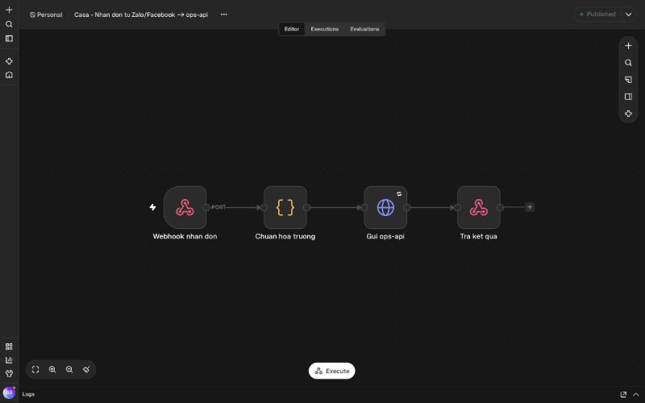
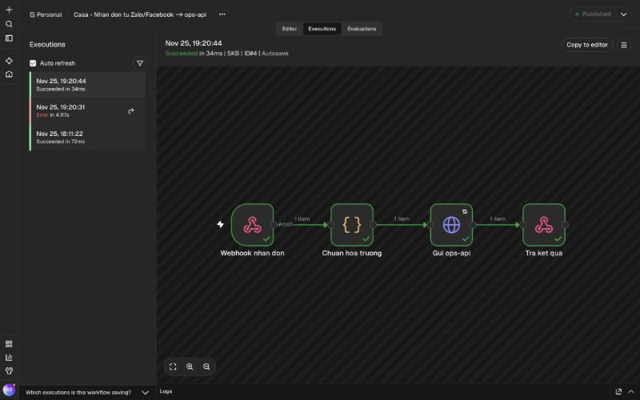
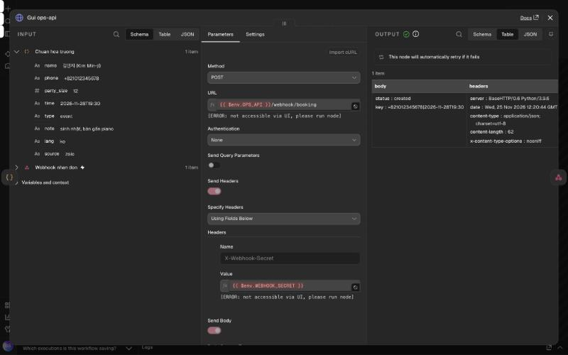
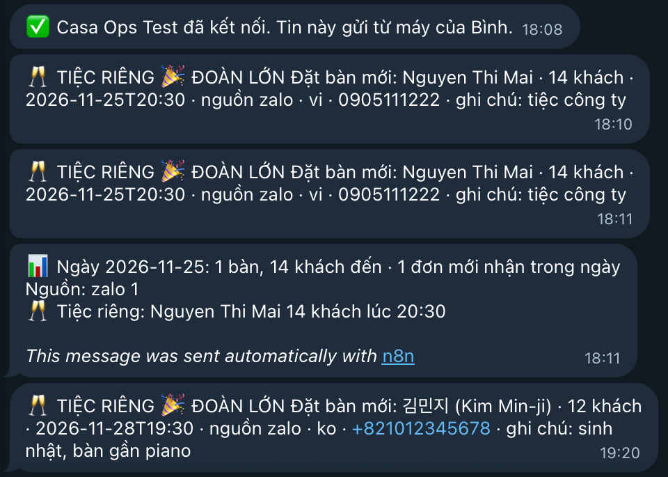

# Chạy thật luồng n8n với Telegram (25/11/2026)

Máy Mac, n8n 2.49.5, ops-api chạy cùng máy, bot Telegram thử `@casa_ops_binh_bot` gửi về điện thoại quản lý.
Script chạy: import credential (secret webhook, token Telegram), import và publish workflow, `n8n start`, gửi đơn thử.

| Bước | Kết quả |
|---|---|
| Gửi đơn 14 người, tiệc công ty, nguồn Zalo vào `POST /webhook/booking` của n8n | n8n chuyển sang ops-api, trả `{"status":"created"}`, ops-api ghi đơn và báo Telegram (gắn nhãn ĐOÀN LỚN, TIỆC RIÊNG) |
| Gửi cùng đường đó với secret sai | n8n trả 403, không tới ops-api |
| Chạy workflow báo cáo (`n8n execute`) | Lấy `/report` từ ops-api, gửi Telegram, API trả `"ok": true` |

## Lỗi tìm ra khi chạy thật và đã sửa

1. Node Webhook trong `1-nhan-don-kenh-khac.json` thiếu `webhookId`. Import và publish vẫn báo thành công nhưng n8n không đăng ký đường `/webhook/booking` (trả 404). Đã thêm `webhookId`.
2. Workflow báo cáo chỉ có lịch 22h nên không chạy tay được bằng `n8n execute`. Đã thêm node "Chay tay" để quản lý chạy lại báo cáo bất kỳ lúc nào.

Lưu ý khi cài: n8n 2.x chặn đọc biến môi trường trong node theo mặc định, cần `N8N_BLOCK_ENV_ACCESS_IN_NODE=false` (hoặc chuyển sang n8n Variables). Credential Telegram và webhook secret tạo trong n8n, không nằm trong repo.

## Ảnh chụp giao diện n8n (25/11/2026, 19:20)

Đơn thử: 김민지, 12 khách, tiệc sinh nhật, nguồn Zalo, tiếng Hàn.

Trong danh sách lần chạy có một lần báo lỗi lúc 19:20:31. Lúc đó ops-api chưa bật nên n8n không gửi được đơn. Bật ops-api rồi gửi lại thì chạy thành công.

## Tin báo trên Telegram của quản lý

- 18:08: tin kết nối thử.
- 18:10 và 18:11: đơn Nguyen Thi Mai 14 khách, gắn nhãn TIỆC RIÊNG và ĐOÀN LỚN. Có 2 tin vì script chạy thử 2 lần, mỗi lần dùng một sổ đơn mới. Trong cùng một sổ, đơn trùng chỉ báo 1 lần (có bài test chống trùng).
- 18:11: báo cáo ngày do workflow n8n gửi.
- 19:20: đơn tiếng Hàn 김민지 12 khách qua n8n, đúng lần chạy trong ảnh ở trên.

Số điện thoại trong ảnh là số mẫu dùng để thử.
