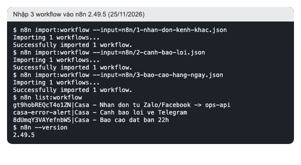

# Bằng chứng nhập workflow n8n (25/11/2026)

Chạy `N8N_USER_FOLDER=<thư mục trống> npx n8n@2.49.5 import:workflow --input=n8n/<file>.json` cho cả 3 file, rồi `n8n list:workflow`:

```
$ n8n import:workflow --input=n8n/1-nhan-don-kenh-khac.json
Importing 1 workflows...
Successfully imported 1 workflow.
$ n8n import:workflow --input=n8n/2-canh-bao-loi.json
Importing 1 workflows...
Successfully imported 1 workflow.
$ n8n import:workflow --input=n8n/3-bao-cao-hang-ngay.json
Importing 1 workflows...
Successfully imported 1 workflow.
$ n8n list:workflow
gt9hobREQcT4o1ZN|Casa - Nhan don tu Zalo/Facebook -> ops-api
casa-error-alert|Casa - Canh bao loi ve Telegram
8dUmqY3VAYefnbWS|Casa - Bao cao dat ban 22h
$ n8n --version
2.49.5
```



Lần này chỉ nhập và liệt kê workflow. Muốn chạy thật cần đặt `OPS_API`, secret và token Telegram trong n8n.
